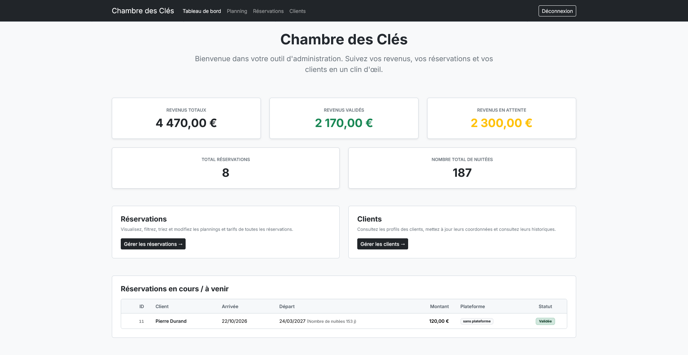
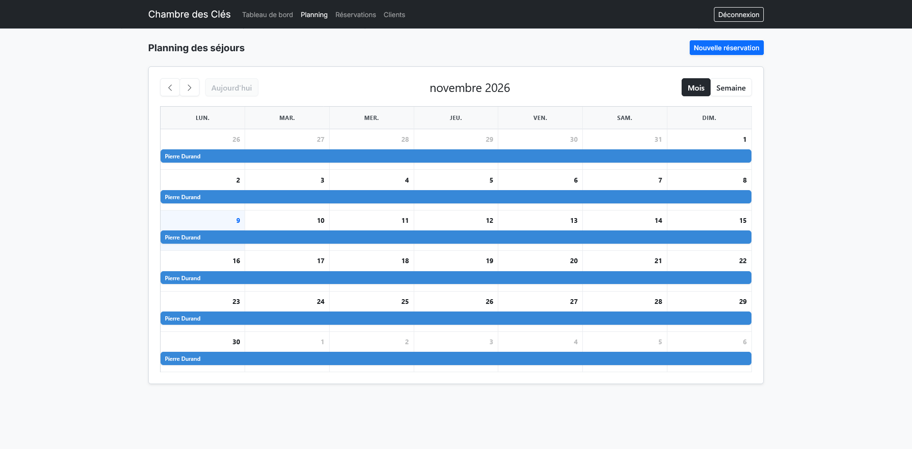
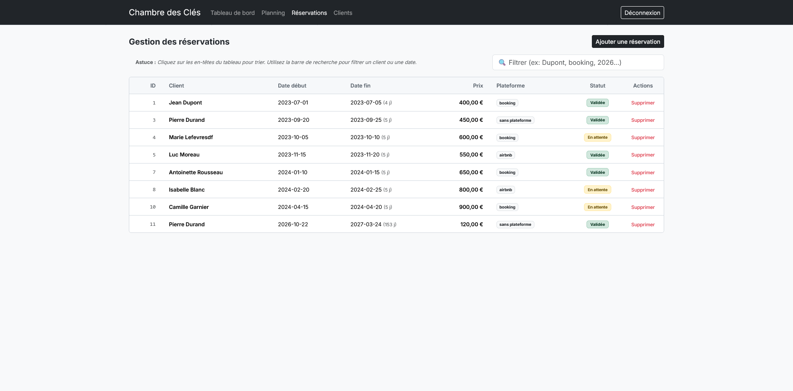
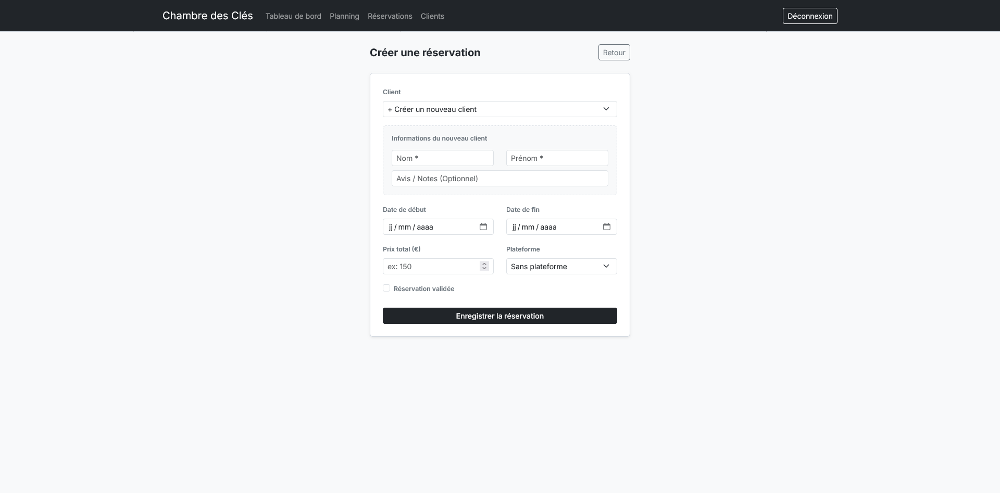
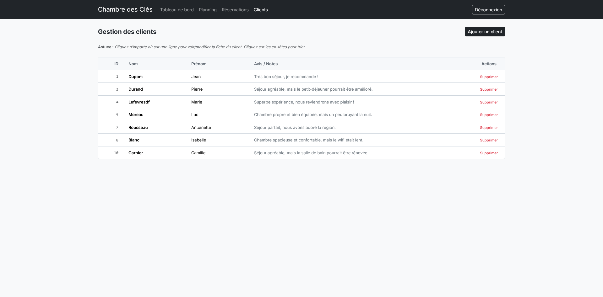
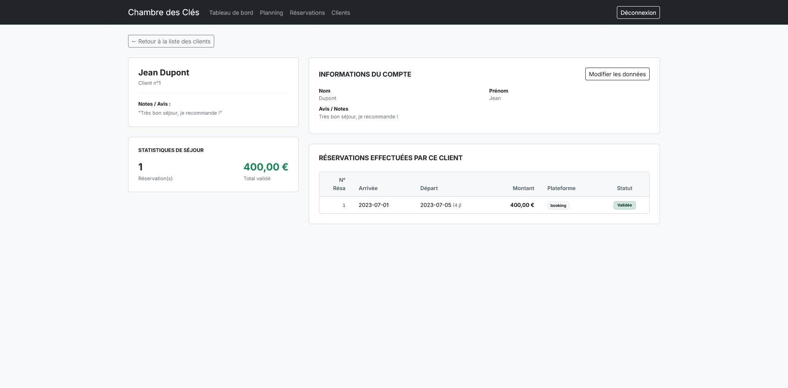

# Chambre des Clés

*Chambre des Clés* is a lightweight web application for managing short-term rental reservations. It features an administrative dashboard, client and booking listings, and automated PDF invoice generation for each reservation.

The project is built with native PHP, uses **Dompdf** for PDF generation, and includes a minimal Docker environment for easy deployment.

---

## Screenshots

### Dashboard



> Administrative home dashboard presenting key metrics, active stays, and quick navigation.

---

### Reservation Calendar



> Visual occupancy schedule displaying room availability and booking timelines.

---

### Reservations List



> Complete reservations overview with status tracking, dates, total amounts, and PDF invoice generation.

---

### New Reservation



> Booking creation form allowing room assignment, date selection, and automated price calculation.

---

### Clients Directory



> Centralized client directory displaying contact details and quick links to customer profiles.

---

### Client Profile



> Detailed client profile view showcasing personal information and full booking history.

---

## Features

- Dashboard displaying key metrics (current reservations, upcoming stays, etc.)
- CRUD lists for clients and reservations
- Automated PDF invoice generation with a clean and responsive template
- Secure session handling using `SameSite=Strict`, `HttpOnly`, and `Secure` cookie flags
- Dependency management via Composer, isolated in the `vendor/` directory
- Minimal Docker image based on `php:8.2-apache` with only required extensions

---

## Prerequisites

- PHP >= 8.0
- Composer (to install dependencies)
- Docker (optional, for containerized deployment)
- MariaDB

---

## Installation

1. **Clone the repository**
   ```bash
   git clone https://github.com/yourusername/ChambreDesCles.git
   cd ChambreDesCles
   ```

2. **Install PHP dependencies**
   ```bash
   composer install
   ```
   This downloads Dompdf and its dependencies into the `vendor/` directory.

3. **Configure the database**
   - Create a MySQL database (e.g., `chambre_des_cles`).
   - Update credentials in `app/utils/db.php`.

4. **Configure the web server**
   - Point your Apache `DocumentRoot` to the `app/` directory.
   - Enable `mod_rewrite` to allow URL routing via `.htaccess`.

---

## Usage

- Access the application at `http://localhost:8080` (or your configured host).
- The dashboard (`app/index.php`) provides an overview of reservations.
- Navigate to **Clients** and **Reservations** pages to manage data.
- From a reservation detail page, click **"Print invoice (PDF)"** to generate and view the invoice.

---

## Docker Deployment (Optional)

A minimal Docker configuration is provided.

1. **Build the image**
   ```bash
   docker compose build
   ```

2. **Run the container**
   ```bash
   docker compose up -d
   ```

   The container maps the `app/` directory to `/var/www/html` and mounts `vendor/` so that Composer dependencies are available.

---

## License

This project is licensed under the MIT License. See the [LICENSE](LICENSE) file for details.
